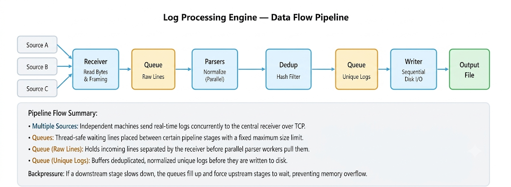

# Multi-Source Log Normalization & High-Performance Analytics Engine

A multi-threaded C++ log processing, normalization, and deduplication engine designed to ingest heterogeneous log streams concurrently from multiple remote TCP sources. The engine normalizes raw data into a unified schema, filters duplicates in real-time using lock-striped sharded hash sets, and sequentially writes clean records to disk under strict bounded-memory constraints.

---

## 1. System Architecture & Visual Data Flow

The engine is engineered as a multi-stage concurrent pipeline connected via thread-safe bounded queues. If downstream processing slows down, bounded queues enforce thread blocking, which propagates network-level backpressure via TCP flow control to remote senders, preventing application memory exhaustion (OOM crashes).

```text
  [ CLIENTS / SOURCES ]
    JSON   Syslog   Apache
      │      │      │
      └───┬───┴───┬───┘
          │ (Raw TCP Byte Streams)
          ▼
┌─────────────────────────┐
│     1. RECEIVER         │ ─── [Partial line on disconnect] ───► 📁 quarantine.log
│  (Sliding Byte Buffer)  │
└───────────┬─────────────┘
            │ Complete lines (\n)
            ▼
    (Queue 1: Lock-Free Ring Buffer)
            │
            ├───────────────┬───────────────┐
            ▼               ▼               ▼
    ┌───────────────┐┌───────────────┐┌───────────────┐
    │ Parser Thread ││ Parser Thread ││ Parser Thread │  (Parser Pool)
    └───────┬───────┘└───────┬───────┘└───────┬───────┘
            │               │               │
            │  [Malformed / Unknown Format]   └─────────────────► 📁 quarantine.log
            ▼
    ┌─────────────────────────────────────────────────┐
    │ 2. SHARDED DEDUPLICATION (Lock-Striped Hash)    │
    │                                                 │
    │   Fingerprint % 16  ──►  Lock Shard [0..15]     │
    └───────────────┬─────────────────────────────────┘
                    │
                    ├─── [Duplicate Found] ────────────► 🗑️ Dropped (Counter + 1)
                    │
                    ▼ (Unique LogEntry)
    (Queue 3: Bounded Queue)
                    │
                    ▼
    ┌─────────────────────────┐
    │ 3. DISK WRITER (Single) │
    └───────────┬─────────────┘
                │
                ▼
      📁 normalized_output.log
```


---

## 2. File & Directory Structure

```text
.
├── include/
│   ├── LockFreeBoundedQueue.h  # Atomic circular ring buffer (SPSC/MPMC)
│   ├── BoundedBlockingQueue.h  # Fallback condition-variable queue
│   ├── LogEntry.h              # Unified schema struct & hash wrapper
│   ├── Receiver.h              # Socket listener & stream framer
│   ├── ParserPool.h            # Multi-threaded format normalizer
│   ├── ShardedDedup.h          # Lock-striped exact hash filter
│   └── DiskWriter.h            # Sequential file flusher thread
├── src/
│   ├── Receiver.cpp
│   ├── ParserPool.cpp
│   ├── ShardedDedup.cpp
│   ├── DiskWriter.cpp
│   └── main.cpp                # Orchestrator & signal handling setup
├── tests/
│   └── log_simulator.py        # Multi-source concurrent log generator
├── Makefile / CMakeLists.txt
└── README.md
```

### Component Mapping

| Component | Category | File Location | Class / Module | Pipeline Stage |
| :--- | :--- | :--- | :--- | :--- |
| Sliding Byte Buffer | Data Structure | `include/Receiver.h`, `src/Receiver.cpp` | `Receiver` | Network Ingestion (Stage 1) |
| Lock-Free Ring Buffer | Data Structure | `include/LockFreeBoundedQueue.h` | `LockFreeBoundedQueue` | Inter-stage: Queue 1 & Queue 3 |
| Unified Log Schema | Data Structure | `include/LogEntry.h` | `struct LogEntry` | Internal Data Representation |
| Lock-Striped Sharded Hash Set | Data Structure | `include/ShardedDedup.h`, `src/ShardedDedup.cpp` | `ShardedDedup` | Deduplication Store (Stage 3) |
| Byte-Stream Framing Algorithm | Algorithm | `src/Receiver.cpp` | `Receiver::process_bytes()` | Ingestion $\rightarrow$ Queue 1 |
| Format Detection & Normalization | Algorithm | `include/ParserPool.h`, `src/ParserPool.cpp` | `ParserPool::worker_loop()` | Parsing & Normalization (Stage 2) |
| MurmurHash3 (64-bit) | Algorithm | `src/ParserPool.cpp`, `include/LogEntry.h` | `LogEntry::compute_hash()` | Pre-Deduplication Fingerprinting |
| Modulo Partitioning & Dedup | Algorithm | `src/ShardedDedup.cpp` | `ShardedDedup::is_duplicate()` | Deduplication Routing (Stage 3) |
| Sequential Persistence Pattern | Algorithm / Pattern | `include/DiskWriter.h`, `src/DiskWriter.cpp` | `DiskWriter` | Persistence to Disk (Stage 4) |
| TCP Zero Window Backpressure | Algorithm / Pattern | Kernel $\leftrightarrow$ `src/Receiver.cpp` | `Receiver` (halts `read()`) | System-wide Flow Control |

---

## 3. Core Data Structures (Deep Dive)

### 1. Sliding Linear Byte Buffer (`std::vector<char>`)

* **Where it is in the code:**  
  * Files: `include/Receiver.h`, `src/Receiver.cpp`  
  * Class: `Receiver`  
* **Where it runs in the pipeline:**  
  Stage 1 (Network Ingestion): Allocated dynamically and maintained in memory per active TCP socket connection.  
* **How it works:**  
  Acts as an in-memory scratchpad for streaming byte fragments. Because TCP chunks do not guarantee message boundaries, bytes arriving from `recv()` calls are appended to the buffer. Once full lines are extracted, unparsed trailing fragments are shifted to index 0 using efficient memory moves.

#### Alternatives Considered

| Alternative | Why It Was Rejected |
| :--- | :--- |
| Fixed-Size Static Buffer (e.g., `char buf[2048]`) | **Buffer overflow and truncation risk.** If a remote client sends a 15 KB stack trace or giant JSON payload on a single line, a fixed buffer either truncates data or crashes the thread. |
| Circular Byte Ring Buffer | **Pointer fragmentation complexity.** Scanning for delimiters across wrapping boundary pointers increases CPU instruction overhead compared to a contiguous linear buffer with shifting. |

---

### 2. Lock-Free Bounded Circular Ring Buffer (`LockFreeBoundedQueue<T>`)

* **Where it is in the code:**  
  * File: `include/LockFreeBoundedQueue.h` (instantiated in `src/main.cpp`)  
  * Class: `LockFreeBoundedQueue<T>`  
* **Where it runs in the pipeline:**  
  * Queue 1: Connects Receiver $\rightarrow$ Parser Pool (holds raw `std::string` lines).  
  * Queue 3: Connects Sharded Dedup Engine $\rightarrow$ Disk Writer (holds normalized `LogEntry` objects).  
* **How it works:**  
  A fixed-capacity circular array where producer and consumer threads coordinate using atomic head and tail sequence markers (`std::atomic<size_t>`) and CPU memory fences (`std::memory_order_acquire` / `release`).  
  Avoids kernel context switches. Producers safely spin-pause during momentary saturation before falling back to wait states, maintaining sub-microsecond item handoffs.

#### Alternatives Considered

| Alternative | Why It Was Rejected |
| :--- | :--- |
| Unbounded Queue (`std::queue` with lock) | **Causes Out-Of-Memory (OOM) crashes.** If remote senders push 1,000,000 logs/sec and the disk can only flush 500,000 logs/sec, memory expands without bound until process termination. |
| Standard Mutex Queue (`std::mutex` + `std::condition_variable`) | **High context-switching overhead.** Entering kernel space to arbitrate locks millions of times per second degrades throughput and spikes CPU latency under heavy load. |

---

### 3. Unified Log Schema (`struct LogEntry`)

* **Where it is in the code:**  
  * File: `include/LogEntry.h`  
  * Struct: `LogEntry`  
* **Where it runs in the pipeline:**  
  Flowing through Stage 2 (Parser Pool) $\rightarrow$ Stage 3 (Dedup Engine) $\rightarrow$ Queue 3 $\rightarrow$ Stage 4 (Disk Writer).  
* **How it works:**  
  Standardizes disparate formats into a canonical, memory-aligned representation:

```cpp
struct LogEntry {
    std::string timestamp;   // Standardized ISO-8601 UTC string
    std::string log_level;   // INFO, WARN, ERROR, DEBUG
    std::string host_source; // Client IP / Origin identifier
    std::string message;     // Sanitized message body
    uint64_t fingerprint;    // Precomputed 64-bit MurmurHash3 key
};
```

#### Alternatives Considered

| Alternative | Why It Was Rejected |
| :--- | :--- |
| Generic JSON / Key-Value Map (`std::map<string, string>`) | **Massive heap allocation overhead.** Node-based maps allocate each node dynamically on the heap, thrashing CPU cache locality and adding substantial memory fragmentation. |
| Raw Unparsed Text Buffers | **Requires downstream re-parsing.** Omitting a standardized struct forces deduplication and disk-writing stages to parse strings repeatedly, multiplying CPU load. |

---

### 4. Lock-Striped Sharded Hash Set

* **Where it is in the code:**  
  * Files: `include/ShardedDedup.h`, `src/ShardedDedup.cpp`  
  * Class: `ShardedDedup`  
* **Where it runs in the pipeline:**  
  Stage 3 (Deduplication): The core deduplication memory store.  
* **How it works:**  
  Rather than protecting a single hash set with one global lock, the store partitions memory into an array of $N$ shards (typically 16):

```cpp
struct Shard {
    std::mutex mtx;
    std::unordered_set<uint64_t> fingerprints;
};
std::vector<Shard> shards;
```

Lock acquisition is confined to the specific bucket matching the record's fingerprint, enabling up to 16 parallel threads to perform lookups and insertions concurrently without contention.

#### Alternatives Considered

| Alternative | Why It Was Rejected |
| :--- | :--- |
| Single Global Hash Set (One `std::unordered_set` + 1 lock) | **Global lock contention bottleneck.** Worker threads spend the majority of their clock cycles stalled behind a single lock mutex, nullifying multi-core scalability. |
| Bloom Filter (Probabilistic bit array) | **Risks dropping unique logs (False Positives).** A standard Bloom filter can mistakenly flag a novel entry as already seen. Dropping unique data breaks the engine's strict lossless guarantee. |
| Distributed / Remote Cache (Redis / Memcached) | **High network latency.** Querying an external cache over localhost or network incurs $0.5\text{ ms}$ to $2\text{ ms}$ per operation. Local RAM lookups complete in $20$ to $50\text{ nanoseconds}$ (roughly 10,000× faster). |

---

## 4. Core Algorithms & Concurrency Techniques (Deep Dive)

### 1. Byte-Stream Framing Algorithm (Scanner)

* **Where it is in the code:**  
  * Files: `include/Receiver.h`, `src/Receiver.cpp`  
  * Function: `Receiver::process_bytes()`  
* **Where it runs in the pipeline:**  
  Stage 1 (Network Ingestion): Translates raw byte streams into discrete string records.  
* **How it works:**  
  * Inspects the active connection's sliding byte buffer linearly for newline delimiters (`\n`).  
  * For every delimiter located, slices a complete string line and immediately enqueues it into Queue 1.  
  * Shifts uncompleted trailing bytes to the start of the buffer.  
  * **Disconnect Handling:** If a socket terminates mid-frame, the leftover buffer fragment is routed directly to `quarantine.log` with the metadata reason `incomplete_frame_connection_reset`.

#### Alternatives Considered

| Alternative | Why It Was Rejected |
| :--- | :--- |
| Line-by-line reading (`std::getline()` / `readline()`) | **Fails on partial/asynchronous TCP streams.** TCP is stream-oriented, not message-oriented. Records can arrive fragmented across packets. Blocking stream readers stall threads and cannot isolate partial lines cleanly upon disconnect. |

---

### 2. Format Detection & Schema Normalization Algorithm

* **Where it is in the code:**  
  * Files: `include/ParserPool.h`, `src/ParserPool.cpp`  
  * Function: `ParserPool::worker_loop()`  
* **Where it runs in the pipeline:**  
  Stage 2 (Normalization): Executed concurrently by a pool of parser worker threads.  
* **How it works:**  
  * Pops raw log lines from Queue 1.  
  * Runs signature-matching heuristics across supported formats in order:  
    1. **JSON:** Scans for enclosing `{ ... }` and extracts standardized keys (`timestamp`, `level`, `host`, `msg`).  
    2. **Syslog (RFC 3164 / 5424):** Matches priority tags `<PRI>`, timestamps, and facility names.  
    3. **Apache Common/Combined:** Extracts client IP, ident, authuser, timestamp brackets, and HTTP request lines.  
    4. **Key-Value Pairs:** Splits on whitespace and key-delimiter tokens (`key=value`).  
  * Converts detected timestamps to standard ISO-8601 UTC strings.  
  * Constructs a normalized `LogEntry`.  
  * **Quarantine Fallback:** Unrecognized or corrupt records bypass downstream queues and append directly to `quarantine.log` with reason: `"unknown_format"`.

#### Alternatives Considered

| Alternative | Why It Was Rejected |
| :--- | :--- |
| Heavy Generic Regex Engines (`std::regex`) | **Severe throughput degradation.** `std::regex` in C++ has substantial performance overhead. Fast manual string scanning, prefix checks, and string-view algorithms yield orders of magnitude higher throughput. |

---

### 3. Fast Fingerprinting Algorithm: MurmurHash3 (64-bit)

* **Where it is in the code:**  
  * Files: `src/ParserPool.cpp`, `include/LogEntry.h`  
  * Function: `LogEntry::compute_hash()`  
* **Where it runs in the pipeline:**  
  Boundary of Stage 2 $\rightarrow$ Stage 3: Executed immediately after normalization before entering the deduplication engine.  
* **How it works:**  
  * Concatenates canonical log identity keys: `timestamp` + `host_source` + `message`.  
  * Runs a 64-bit non-cryptographic MurmurHash3 mixing algorithm over the byte string.  
  * Produces a uniform 64-bit unsigned integer (`uint64_t`) stored inside `LogEntry::fingerprint`.

#### Alternatives Considered

| Alternative | Why It Was Rejected |
| :--- | :--- |
| Cryptographic Hashes (SHA-256 or MD5) | **Massive CPU bottleneck.** SHA-256 is designed to resist preimage and collision attacks, making it 10× to 50× slower. Because log deduplication requires identity checking rather than tamper resistance, cryptographic hashing wastes compute cycles. |
| Raw String Keying (Direct string comparison) | **High memory consumption.** Storing 10 million raw log strings (averaging 200 bytes each) requires ~2 GB of RAM. Storing 10 million 8-byte integers requires only ~80 MB, fitting easily within L3/system cache limits. |

---

### 4. Shard Partitioning & Deduplication Algorithm

* **Where it is in the code:**  
  * Files: `include/ShardedDedup.h`, `src/ShardedDedup.cpp`  
  * Function: `ShardedDedup::is_duplicate()`  
* **Where it runs in the pipeline:**  
  Stage 3 (Deduplication): Arbitrates record uniqueness across parser threads.  
* **How it works:**  
  * Computes the target shard index via modulo arithmetic:  
    $$\text{shard\_index} = \text{fingerprint} \pmod{\text{NUM\_SHARDS}}$$  
  * Locks only the `std::mutex` dedicated to `shards[shard_index]`.  
  * Checks `fingerprints.find(fingerprint)`:  
    * **If present:** Unlocks shard, increments atomic counter `duplicates_dropped`, and discards the record.  
    * **If absent:** Inserts fingerprint into the shard's set, unlocks shard, and pushes the unique `LogEntry` into Queue 3.

#### Alternatives Considered

| Alternative | Why It Was Rejected |
| :--- | :--- |
| Global Hash Table Lookup | **Thread serialization.** All parser threads stall competing for a single lock, capping throughput to a single core's speed regardless of system hardware. |

---

### 5. Persistence Pattern: Single-Writer Sequential Disk I/O

* **Where it is in the code:**  
  * Files: `include/DiskWriter.h`, `src/DiskWriter.cpp`  
  * Class: `DiskWriter` (runs inside its own dedicated `std::thread`)  
* **Where it runs in the pipeline:**  
  Stage 4 (Disk Persistence): The terminal exit stage for unique normalized logs.  
* **How it works:**  
  * A single dedicated consumer thread reads normalized records from Queue 3.  
  * Formats records and appends them sequentially to `normalized_output.log`.  
  * Executes buffered bulk writes to disk, ensuring maximum write throughput without thread contention.

#### Alternatives Considered

| Alternative | Why It Was Rejected |
| :--- | :--- |
| Concurrent File Writing (Multiple threads writing to disk) | **File locking & fragmented I/O.** Multiple threads competing for file pointers cause kernel mutex contention and non-sequential writes, degrading disk throughput. |
| Relational Database (SQLite / PostgreSQL) | **Unnecessary write amplification.** Databases incur write-ahead logging (WAL), page index rebalancing, and transaction isolation overhead. For high-speed log ingestion, raw sequential file append maximizes physical storage bandwidth. |

---

### 6. Cascading Flow Control & Backpressure Algorithm

* **Where it is in the code:**  
  Trigger Chain: `DiskWriter.cpp` $\rightarrow$ `ShardedDedup.cpp` $\rightarrow$ `ParserPool.cpp` $\rightarrow$ `Receiver.cpp` $\rightarrow$ OS TCP Kernel.  
* **Where it runs in the pipeline:**  
  System-Wide Reverse Cascade: Propagates from Stage 4 backward to remote TCP clients.  
* **How it works:**  
  When disk writing stalls, backpressure propagates upstream without dropping internal data:

```text
[ Disk Writer Slows Down ]
           │
           ▼
Queue 3 Reaches Max Capacity (Bounded Limit)
           │
           ▼
Deduplication Engine Blocks on Queue 3 Push
           │
           ▼
Parser Pool Blocks on Queue 1 Pop / Dedup Push
           │
           ▼
Queue 1 Reaches Max Capacity
           │
           ▼
Receiver Thread Blocks on Queue 1 Push (Stops issuing recv() / read())
           │
           ▼
Kernel TCP Receive Buffer (SO_RCVBUF) Fills to Capacity
           │
           ▼
OS Transmits TCP Zero Window Signal (Window Size = 0)
           │
           ▼
[ Remote Client TCP Stack Pauses Outbound Transmission ]
```

#### Alternatives Considered

| Alternative | Why It Was Rejected |
| :--- | :--- |
| Drop-Tail / Drop on Busy (Discarding logs on queue full) | **Violates the zero-record-loss guarantee.** Silently dropping logs during traffic spikes compromises security audits and system analytics. |
| Disk Spilling / Swap Files (Overflow queues to disk) | **Worsens the primary bottleneck.** If disk I/O is already saturated, writing unparsed raw data to swap drives compounds disk head thrashing and latency. |

---

## 5. System Invariants & Accounting Rules

### The Three Exit Routes

Every incoming raw log byte must be accounted for across exactly three terminal destinations:

```text
Total Ingestion Stream
         │
         ├──► 📁 quarantine.log         (Malformed / Incomplete frames)
         ├──► 🗑️ Duplicates Dropped      (Redundant records)
         └──► 📁 normalized_output.log   (Clean, unique records)
```

### The Conservation Invariant

To verify data integrity and zero internal drop loss, the system verifies the following equality upon test completion:

$$\text{Total Lines Received} = \text{Lines Written to Output} + \text{Duplicates Dropped} + \text{Quarantined Lines}$$

* **Dashboard Out of Scope:** In alignment with core high-performance headless architecture, graphical/web dashboards are omitted. Validation is conducted via terminal execution counters, atomic metrics, and programmatic exit codes.  
* **Lossless Ingestion Definition:** Bounded queues paired with TCP Zero-Window signaling ensure zero unhandled memory drops or internal process discards.

---

## 6. Building and Running

### Prerequisites

* C++17 or C++20 compliant compiler (`g++ 9+` or `clang++ 10+`)  
* POSIX Threads (`pthread`)  
* CMake 3.14+ (optional, for build orchestration)  

### Build Commands

```bash
mkdir -p build && cd build
cmake -DCMAKE_BUILD_TYPE=Release ..
make -j$(nproc)
```

### Execution

```bash
./log_processor_engine \
  --port 8080 \
  --output normalized_output.log \
  --quarantine quarantine.log
```